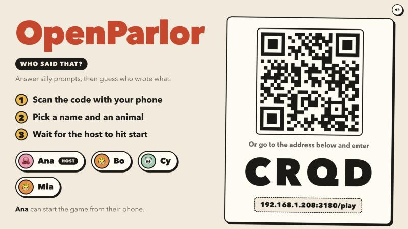
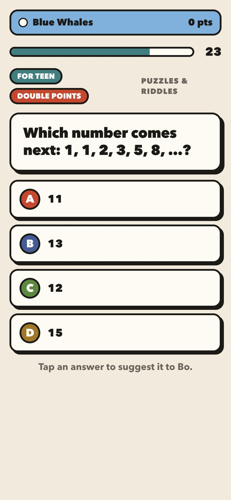
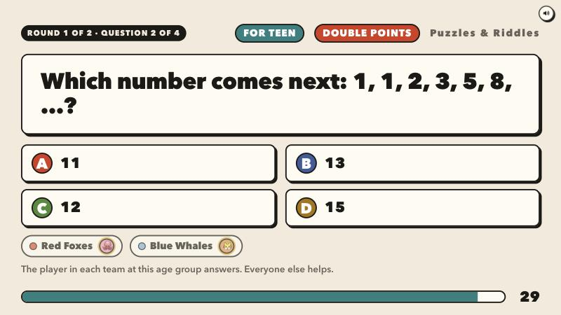
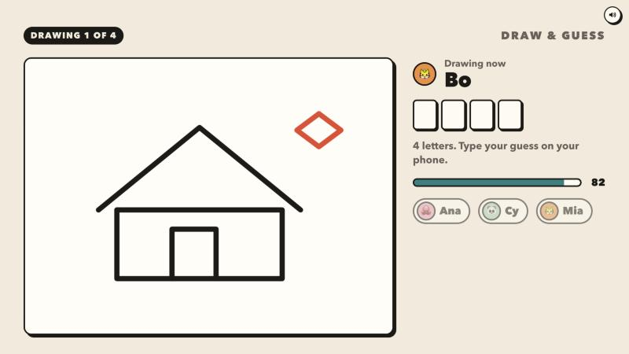

# OpenParlor

**Party games for the room you are in.** One computer runs the server, a TV (or any big screen) shows the game, and everyone plays on their own phone by scanning a QR code. No accounts, and no internet once it is running.

It works for a family, a classroom, a club or a party, and a room can hold a hundred people: anyone who just wants to watch joins the audience, sends emoji reactions to the big screen and votes in the quiz's crowd poll. Group names, difficulty levels, branding and content are all configurable, and you can add your own games.

| The big screen | Everyone's phone |
|---|---|
|  |  |

## Run it

    npm install
    npm start

Open the "On your network" address it prints (for example `http://192.168.1.20:3100`) on the TV, tap **Put it on the big screen**, and scan the QR code with phones. Phones can also open **Practice on your own** (`/solo`) without a TV.

Needs **Node 22.13 or newer** (`nvm use` picks the right one). Use `PORT=4000 npm start` to change the port.

## Games

- **Who Said That?**: answer a prompt, then guess who wrote each answer. Anyone can pass on a prompt, and the host can hide an answer.
- **Draw & Guess**: one person draws on their phone, the TV shows it live, everyone else guesses. At the end, drawings appear in a gallery with a **Save** link.
- **Quiz Show**: teams answer multiple-choice questions, with one double-points question each round and a final wager. Each question is aimed at one level, and the player on each team at that level locks the answer while teammates tap suggestions to help. The host can have the TV read questions aloud.
- **Mini-Games**: quick rounds across 8 games (**Word Builder**, **Word Match**, **Number Dash**, **Logic Chain**, **Memory Match**, **Copy Cat**, **Colour Clash**, **Quick Tap**). Play as a ranked race, or together for a saved group record.

Every game starts with a **How to play** screen on the TV and phones. The host can skip it, pause timers, pass host to someone else, or let anyone take over as host (this can be switched off).

## Use it like an app

On a phone, use **Add to Home Screen** to open it full screen with its own icon. Screens stay awake during a game, and a phone that locks or loses Wi-Fi reconnects by itself. For offline Solo Practice and the install prompt, turn on https with `npm run cert`. See [docs/PWA.md](docs/PWA.md).

## Add your own games

Games and mini-games are plugins. Copy a folder into `plugins/`, restart, and it appears in the lobby. Two complete examples are in `examples/`, and [docs/GAME-SDK.md](docs/GAME-SDK.md) explains the format. Plugins are trusted code that runs inside the server, so only install ones you trust.

## Levels (bands)

Players choose a **band** when they join, for example Kid, Teen or Adult. Bands only change how hard things are: which questions you get, how big the memory board is, and so on, so a mixed group can play fairly together. You decide what the bands are called and how many there are. A preset picks them for you:

| Preset | Bands |
|---|---|
| `family` (default) | Kid, Teen, Adult |
| `classroom` | Younger students, Older students, Teachers and guests |
| `party` | one band for everyone, handicaps off |

    PRESET=party npm start

## Configuration

Settings live in `config/default.json` and the presets in `config/presets/`. To change something without editing those files, create `config/local.json` (it is not committed):

    {
      "preset": "classroom",
      "brand": { "name": "Room 12 Quiz Night", "tagline": "Friday at 3" },
      "limits": { "maxPlayers": 40 },
      "host": { "allowClaim": false },
      "profiles": { "enabled": false }
    }

See [docs/CONFIG.md](docs/CONFIG.md) for every option, how to define your own bands, and the environment variables.

## Your own content

Questions, prompts and word lists are plain JSON in `content/`. To add your own, drop a file into `content/packs/` and restart. No code needed. See [docs/CONTENT-PACKS.md](docs/CONTENT-PACKS.md) for the formats. Run `npm run validate` to check your files.

## Profiles, scores and Solo Practice

If profiles are enabled (the default), tapping a saved profile on `/play` or `/solo` remembers your name, animal and band. Personal bests, daily streaks, every finished game and the group records are saved in a SQLite database (`data/openparlor.db`), with a daily backup. `/stats` shows the best scores and recent games, and each person can download or delete their own data. Turn profiles off in the config if you do not want anything saved about people. See [docs/DATA.md](docs/DATA.md).

## Sound and theme

Sound effects are generated in the browser, so there are no audio files. The TV plays shared cues and each phone plays private feedback. Click anywhere on the TV page once to enable audio, and use the speaker button (or press `M` on the TV) to mute. The look follows the device's light or dark setting.

## Development

    npm run lint        # ESLint
    npm test            # robustness, configuration, plugin and whole-game tests
    npm run validate    # checks every content file and exits 1 if a pack is broken
    npm run backup      # writes a database backup now
    npm run cert        # makes a certificate so the server can use https
    npm run icons       # redraws the app icons

A broken content pack never stops the server from starting: invalid items are skipped with a message that names the file, and a game with no usable content is hidden from the lobby.

## Status

Early (version 0.1). See [ROADMAP.md](ROADMAP.md) for what is planned and what is missing, [CHANGELOG.md](CHANGELOG.md) for what has changed, and [SECURITY.md](SECURITY.md) for what it is, and is not, designed to withstand.

## Contributing

Bug reports, content, plugins and code are welcome. Start with [CONTRIBUTING.md](CONTRIBUTING.md). Everyone taking part is expected to follow the [Code of Conduct](CODE_OF_CONDUCT.md).

## Licence

The code is released under the [MIT License](LICENSE). The questions, prompts and word lists in `content/` are released under [CC BY-SA 4.0](LICENSE-CONTENT.md). The packages it depends on are listed in [THIRD-PARTY-LICENSES.md](THIRD-PARTY-LICENSES.md).
